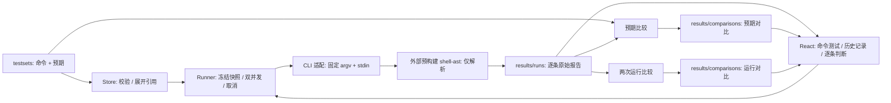

# Shell AST Auditor 架构

## 1. 项目概览

独立的、仅解析的 Shell 回归诊断应用。主工作流是“选择命令 → 在当前页解析 → 在右侧查看预期/审批判断”；历史记录提供运行快照和跨次对比。测试定义、实际观测和判断报告分别存储，稳定 caseId 贯穿三者。

## 2. 技术栈

Go 1.26 标准库 HTTP/文件存储/子进程适配，React 18、TypeScript strict、Vite 5。离线测试用 Go test 与 Vitest，真实页面验证用 Playwright + Google Chrome。无数据库、无父级依赖、无跨子项目源码引用。

## 3. 架构设计



`internal/audit` 是领域层，不依赖 React 或 CLI 私有 Go 包。Parser/Validate 作为函数注入，离线测试可用固定报告而不启动真实 Shell 或解析器。`cmd/server` 负责 CLI 进程与 HTTP 应用装配。前端只读取后端的 Check/Comparison，不另写一套解析判断。

## 4. 目录结构

```text
shell-ast-auditor/
├── testsets/                # 人工维护的测试输入、预期；唯一生效来源
│   ├── shell-core/          # macOS/Linux 233 条：Bash/sh/Zsh
│   ├── windows-core/        # Windows 166 条：PowerShell/CMD
│   ├── windows-smoke/       # 引用 Windows 3 条
│   ├── powershell-compat/   # 105 组输入 × 5.1/7.6；210 条文档推导用例
│   ├── smoke/               # 引用 macOS/Linux 5 条已有 caseId
│   ├── policy-smoke/        # 6 条分类/权限预审（Host 相关）
│   ├── policy-http-regression/ # 13 条 macOS HTTP 取数审批回归
│   └── policy-http-windows/ # 20 条 Windows HTTP 取数审批回归
├── results/                 # 生成数据，运行记录和对比结果，默认 Git 忽略
│   ├── runs/<runId>/        # run.json + reports/<caseId>.json
│   └── comparisons/         # expectations-<runId>.json / compare-*.json
├── evidence/                # 上游只读快照和旧版证据
├── artifacts/               # 生成的截图、页面检查日志
├── internal/audit/
│   ├── model.go             # 测试集、运行、判断、对比类型
│   ├── store.go             # 目录发现、引用展开、原子文件存储
│   ├── runner.go            # 有界解析、状态、取消、重启恢复
│   ├── compare.go           # 实际对预期、运行对运行
│   ├── http.go              # 领域 API
│   └── audit_test.go        # 离线领域与持久化测试
├── cmd/server/              # 解析 CLI 适配与本地应用装配
├── src/
│   ├── domain.ts            # 前端数据合同、源码字节范围辅助
│   ├── api.ts               # HTTP / JSON 导出
│   ├── Inspector.tsx        # 结构树、执行点、诊断、原文高亮
│   ├── ComparisonPanel.tsx  # 对比选择与逐条对应表
│   └── main.tsx             # 测试集、运行选择与页面状态
├── scripts/                 # CLI 构建、可读命令目录生成、集成与浏览器检查
└── bin/、dist/、node_modules/ # 本项目生成产物
```

`COMMANDS.md` 由 JSONL 生成，只供阅读；`npm test` 检查它没有过期，不是第二份维护源。历史混合 data/cases.json 在 evidence/previous/，应用不再加载。

## 5. 数据结构

- **Testset**：manifest 声明本地 JSONL 和其他测试集 caseId 引用。加载时拒绝循环、重复 ID、非法路径和无效预期。
- **Case**：id、command、dialect、profile、options、mode、platforms、tags、expect、source、可选已知差异。源用例和适配出处均保留。
- **Run**：唯一 ID、测试集版本/hash、解析器 SHA-256、主机/时间、冻结 Case 列表、逐条 Result 索引；完整 Report 按 caseId 单独存盘并按需获取。
- **Check**：match/known-difference/mismatch/error/not-run，不用任务 completed 代替通过。
- **Comparison**：保存类型、基准/目标 runId、按 caseId 对齐的行和统计。预期对比行同时给出命令、预期及实际。两次运行的相同 ID 若输入改变，标为 input-changed，不能拿来证明解析退化或改善。

输出 JSON 是解析 CLI 原始报告；不重新实现 Shell 语法。比较原始报告顶层字段、预期变化和退出码；耗时不参与内容相等判断。unchanged 只表示两次观测相同。

## 6. API 定义

| API | 职责 |
| --- | --- |
| GET /api/testsets；GET /api/testsets/:id | 发现测试集、读取展开后的命令和预期 |
| POST /api/runs | `{testsetId, caseIds?}` 创建新运行，省略 caseIds 为整个集 |
| GET /api/runs；GET /api/runs/:id | 历史索引、快照、进度与逐条结果摘要 |
| GET /api/runs/:id/cases/:caseId | 当次单条完整报告与对比结果 |
| POST /api/runs/:id/cancel | 取消正在运行的批次 |
| GET /api/comparisons；GET /api/comparisons/:id | 对比历史与逐条对应结果 |
| POST /api/comparisons | `{baseRunId,targetRunId}` 生成并保存运行对比 |
| POST /api/parse | 自定义文本临时解析，不写固定测试集与运行历史 |
| GET /api/health | 诊断用途与 CLI 文件可用状态 |

预期对比在运行完成/取消后自动生成；服务器重启时也为 interrupted 运行生成未完成的对照表。文件写入失败不能记作通过。仅支持一个服务实例管理本目录，跨进程文件锁/远程协作未实现。

## 7. 开发要点

新增用例和测试集只改 testsets，不改结果文件；新的解析结果由真实运行产生；新的运行对比只引用已保存的运行，不读取当前测试集替换旧预期。新增判断规则集中在 compare.go 并补离线测试。expect.containsArgv 对完整字面 argv 作精确存在性断言，不包含重定向；已知语法差异不能抵消参数缺失。部署方式为本机 Go 服务提供 dist 静态页面，或 Vite 开发代理。

## 8. 开发流程

详见 README 的启动和检查命令，以及 testsets/README 的新增步骤。真实集成检查独立于默认离线测试，产物按运行 ID 保存，不覆盖旧记录。浏览器检查与全量集成检查顺序运行。

## 9. 已知约束与注意事项

consumer=diagnostic；纯语法 classification=not-run，显式分类/预审为 platform-review，exact 不是 allow。当前不替换生产审批，Windows 原生验收 pending。JSON Schema 仍为 draft，Bash exact/partial 仅有窄范围证据。两次相同失败也能 unchanged；已知差异仍是差异。浏览器没有在线编辑测试集文件的功能；文件编辑后生成命令目录并重新加载测试集。临时自定义解析不自动成为正式测试。

## 分类/预审与进程版本

CLI 适配在 cmd/server/parser.go，启动时探测 --help，纯语法显式 --syntax-only；policy 模式按 Input.review 结构化传参。默认核心用例不调用预审，policy-smoke 覆盖分类和 access level。policy-http-regression 与 policy-http-windows 分别覆盖 macOS Bash 和 Windows PowerShell 的 HTTP 取数与权限边界。review 属于输入身份，模式/权限/上下文变化在运行对比中标为 input-changed。

Result.checks.parsing 与 Result.checks.approval 分别保存解析和审批预期比较，CheckReportParts 是唯一判断入口；旧 Result.check 保留综合统计。期望选择由 ExpectedPolicy/expectedPolicy 按冻结请求的 accessLevel 选择 expect.policyByLevel 中的一档，旧 expect.policy 仍兼容分类用例。macOS/Linux 内置用例声明完整三档和依据。Windows 核心集与兼容性用例声明解析预期，默认只解析语法。独立 Windows HTTP 回归集声明三档审批预期，默认执行权限预审。只解析/只分类但有矩阵时为 not-evaluated；无审批预期时为 not-set，实际预审决定仍记录于 Result.policy。旧详情由 Store.Result 根据冻结 Case 和原始报告只读补算，不改写历史。Result.policy 保存可比较摘要，原始完整报告保留全部 requirements；CheckReport 同时校验请求模式、预期分类和决定，分类-only 不能生成 accessLevel 或 decision。前端 PolicyPanel 与 ReviewControls 只展示和收集选择，不自行判断 allow。

先绑定监听端口，再初始化/恢复 Run；重复同项目启动只返回已有服务信息，不干扰活动任务。健康接口含 app、projectRoot、PID、parser 能力和来源。CLI 字节固定到摘要路径，重建不静默改变运行中的解析器。Python 构建脚本只写本项目，记录上游 HEAD + dirty + 源指纹，不将未提交版本冒充正式提交。

## 逐条判断与注意项

`Input.projectDir` 是可选的本机模板目录。`cmd/server/project.go` 在 CLI 之前检查并规范化真实目录、调用领域层 `MapProjectTemplate` 展开 `/project`，冻结有效输入；Runner 注入 Prepare 用于所有选中的用例，临时解析也走同一个函数。原始模板保存在 templateCommand，Case.command/Result.input.command 均为实际 CLI 输入，Inspector 按实际输入显示范围。模板替换仅支持不会改变原始 Shell 引号和参数结构的普通目标路径；不引入另一套 Shell 解析器。projectDir、模板原文、有效目录均参与 Input 比较。UI 默认映射到健康接口的 projectRoot，API 不隐式启用映射，不读取相邻项目凭据或修改被测平台。

ExpectationPanel 只展示当前 Case 与当前 Result，检查结论取后端 Check，不在前端重新计算测试是否通过。judgments.ts 把后端解析与审批预期判断分别转换为可见状态，并统一提供 hasRed 给列表筛选；不从行为分类或解析 grade 推断审批。已知差异保留红色注意标记，实际禁止执行与需审批保留在独立 PolicyPanel 中，未设审批预期不能变成绿色。Inspector 的标签状态独立于轮询更新，主页面不会因单条运行完成而导航到历史。
